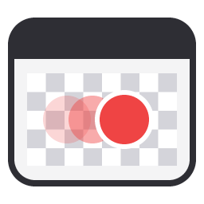

# rcap

A tiny screen-to-GIF recorder for Windows, like LICEcap. Put the window over
what you want to record, press **Record**, press **Stop**, and the GIF is
already on your clipboard, ready to paste into Discord, Slack, etc.

## Install

Download `rcap-vX.Y.Z.exe` from the [Releases](../../releases) page and run it.
There's nothing to install.

Windows may show "Windows protected your PC" because the exe isn't signed.
Click **More info → Run anyway**.

## Use

- Drag the title bar to move, drag the edges to resize, or type a size.
- Set the FPS (10–60, default 30).
- **Record** / **Stop**. The GIF is copied to the clipboard when it's done.
- **Recent** lists your last 10 GIFs; click one to copy it again.

## Build

You need:
- [Rust](https://rustup.rs)
- [Visual Studio Build Tools](https://visualstudio.microsoft.com/visual-cpp-build-tools/)
  with the "Desktop development with C++" workload (rustup offers to install it)

Then:

```
cargo build --release
```

## Run

```
cargo run --release
```

or run `target\release\rcap.exe` directly.

Run the tests with `cargo test`.

## Make a release

1. Bump `version` in `Cargo.toml` (e.g. `0.2.0`) and push to GitHub.
2. Go to **Actions → Release → Run workflow** and click **Run workflow**.

A few minutes later release `v0.2.0` shows up on the Releases page with the
exe attached. The version always comes from `Cargo.toml`, so the exe's
version info matches the release. Each version can only be released once.

## Privacy

This program will not transfer any information to other networked systems
unless specifically requested by the user or the person installing or
operating it. Recordings are saved only to your temp folder
(`%TEMP%\rcap`, newest 10 kept) and your clipboard.

## License

[MIT](LICENSE)
